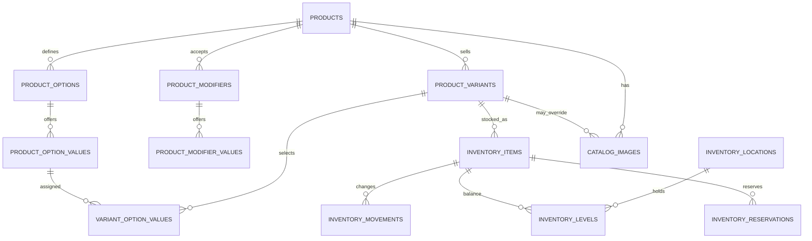

# Proposed product catalog database design

This is a design proposal only. It does not change existing tables or create migrations. Its goal is to add BigCommerce-like options, variants and inventory while preserving current products and API contracts.

## Design constraints

1. Keep the current `products` table and its IDs as product/listing identity. Existing API resources and product URLs continue to resolve by this ID/slug.
2. Add new tenant-local records with explicit `store_id` even though each store currently has a separate database. This maintains the current row ownership convention, supports consistency checks, and avoids accidental exposure if shared-schema tenancy is ever introduced.
3. Use tenant-local foreign keys and composite ownership checks where the MySQL design permits. Enforce `(store_id, id)` unique keys on parent tables when needed to support composite foreign keys, and include `store_id` on pivots/children so references cannot cross store ownership.
4. Treat SKU as a normalized identifier belonging to a sellable inventory item/variant. Preserve product-level `products.sku` as the legacy/simple-product projection during transition.
5. Distinguish variant options from modifiers. A variant option participates in a concrete sellable combination; a modifier captures an extra shopper selection and does not inherently create a new stock item.
6. Preserve existing fields as compatibility inputs/fallbacks until every API, import/export, cart/order flow, and report supports variants.

## Entity relationship overview

The diagram is a target concept. Existing `products`, `product_images`, `category_product`, `categories`, and related product metadata remain in place during migration.

## Proposed tables

Types below are conceptual; choose the exact SQL types and indexes after confirming MySQL version, tenant scale and current schema drift.

### `product_options`

| Column | Purpose |
|---|---|
| `id`, `store_id`, `product_id` | tenant and owning product |
| `name`, `display_name` | stable option name and storefront label, e.g. Color |
| `option_type` | `variant` or a separately modeled modifier; avoid mixing semantics |
| `display_type` | select, radio, swatch, buttons, etc. |
| `position`, `is_required`, `is_visible` | stable storefront order and behavior |
| timestamps | audit |

Unique/indexes: `(store_id, id)`, `(store_id, product_id, position)`, lookup `(store_id, product_id)`; tenant-safe FK to product.

### `product_option_values`

`id`, `store_id`, `product_option_id`, `label`, normalized `value_key`, optional swatch/color/image reference, `position`, `is_default`, timestamps. Enforce one value key per option and tenant. Option values should be product-scoped initially to minimize migration complexity; reusable shared option libraries can be added later with explicit assignment tables.

### `product_variants`

| Column | Purpose |
|---|---|
| `id`, `store_id`, `product_id` | tenant and parent product |
| `sku`, `sku_normalized` | sellable SKU; allow nullable only for legacy transition if policy requires |
| `barcode`, `mpn` | variant-scoped identifiers where supplied |
| `price`, `sale_price`, `cost_price`, `msrp` | nullable overrides; null means inherit from product |
| `weight`, `weight_unit`, `width`, `height`, `depth`, `dimension_unit` | shipping values with explicit units and product fallback |
| `purchasability_status`, `is_default`, `is_active` | selection and lifecycle |
| `combination_key` | deterministic hash of sorted `(option,value)` pairs |
| `position`, timestamps | stable display order |

Enforce unique `(store_id, sku_normalized)` for nonblank SKU and `(store_id, product_id, combination_key)`. Use tenant-safe FK `(store_id, product_id)`; SKU must remain unique across all variants and legacy simple product projections. API/service layer must reject duplicate combinations even if hashes collide or are incorrectly generated.

Every current product should map to one default variant when enabled. Initial backfill copies product SKU, price, sale/cost/MSRP, dimensions, purchasability, stock identity, and primary image mapping. Do not delete or rewrite product identity.

### `variant_option_values`

`store_id`, `product_variant_id`, `product_option_id`, `product_option_value_id`, timestamps. Enforce one selected value per option per variant and tenant-safe composite references. Unique `(store_id, product_variant_id, product_option_id)`; unique assignment tuple to prevent duplicates. The combination key must be generated from option IDs and value IDs in deterministic order.

### Product modifiers (separate from variant options)

`product_modifiers`: `store_id`, `product_id`, name/label, input type, required flag, position, validation/config JSON. `product_modifier_values`: allowed values and optional price/weight adjustments. Add explicit modifier rules only if requirements need conditional changes. Cart/order lines must persist submitted modifier selections and pricing snapshots; never treat a modifier as variant inventory.

### Inventory

#### `inventory_items`

One sellable stock identity per variant (and optionally nonvariant product during migration): `id`, `store_id`, `product_variant_id` nullable only for transition, `sku_normalized`, `tracking_mode` (`none`, `product`, `variant`), `allow_backorder`, timestamps. Unique variant association and tenant SKU policy.

#### `inventory_locations`

`id`, `store_id`, name/code, active state, address/fulfillment metadata. Start with a single default location if multi-location workflows are not required immediately; the schema should not bake a single quantity column into products again.

#### `inventory_levels`

`id`, `store_id`, `inventory_item_id`, `location_id`, `on_hand`, `reserved`, optional safety stock, timestamps/version. Unique `(store_id, inventory_item_id, location_id)`. Available-to-sell is derived from on-hand less reservations/safety stock and backorder policy. Update with row locks or atomic conditional SQL.

#### `inventory_movements` and `inventory_reservations`

Movements are immutable, append-only records: item, location, signed quantity, movement type, source type/id, idempotency key, actor, timestamp. Reservations track checkout/order allocation lifecycle with expiry and states such as held, committed, released. Add unique idempotency keys and indexes for item/location/time and source lookup. Current order/customer-facing product totals can be projected for backwards compatibility.

### Images and product attributes

- Evolve product image metadata with explicit `position`, role, storage key, alt text, and optional `product_variant_id` (or use a separate association table if images need multiple variants). Retain current `product_images` IDs/path/url and existing `ProductImageResource` fields. Add per-tenant/product ordering and enforce at most one chosen primary image according to target behavior.
- Add typed `product_attribute_definitions` and `product_attribute_values`: code/name, data type, unit, searchable/filterable flags, position; values link to product and optionally variant, using typed columns or a validated JSON value plus normalized search strategy. This is distinct from options, modifiers and unstructured custom fields. Keep existing `custom_fields` in API as legacy projection.

### Categories and taxonomy integrity

Keep `categories` and `category_product` initially. Add tenant-safe composite uniqueness/FKs, a `position` on the pivot only if per-category product order is needed, and explicit product primary category semantics. Validate parent and associated category `store_id` at every write. Avoid duplicating category trees until actual multi-channel/catalog assignment needs exist.

## Indexing and tenant strategy

Current physical tenancy uses a separate tenant database per store. Keep all new product tables local to the tenant DB and include `store_id` for compatibility/defense-in-depth. Suggested indexes:

- products: existing `(store_id, sku)` unique plus product listing `(store_id, visible_on_storefront, status, created_at)` as needed;
- variants: unique normalized SKU, unique combination key per product, `(store_id, product_id, is_active, position)`;
- option values: `(store_id, product_option_id, position)`;
- inventory: `(store_id, inventory_item_id, location_id)` unique and reservation state/expiry indexes;
- images/attributes: `(store_id, product_id, position)` and facet-specific indexes based on measured filters.

Do not add every possible index before workload measurement. Catalog search can later use a search index fed by product/variant change events; the database remains the source of truth. Per-store/per-tenant storage also means migrations must run through tenant provisioning/migration services, never merely against the default DB.

## Compatibility and data transition

1. **Additive phase:** keep existing columns, IDs, API payloads and response names. Add new tables and feature flags only after migration design and compatibility review.
2. **Default variant backfill:** create one default variant per existing product; record a persistent product-to-variant mapping. Use idempotent batches, collision reports and restart checkpoints.
3. **Dual projection:** legacy product SKU/price/current stock continue to read/write through a catalog service that maps simple products to their default variant. Avoid direct variant and product writes from separate controllers.
4. **Cart/order snapshots:** new cart items and order lines carry `product_variant_id` plus immutable SKU/name/option/price/weight snapshots. Keep `product_id` for existing reports and APIs. Old cart/order payloads without a variant resolve to the default variant.
5. **Storefront rollout:** expose variant data as additive response fields first. Existing `ProductResource`/`ProductListResource` keys remain unchanged; consumers can adopt selectors gradually.
6. **Stock cutover:** reconcile product `current_stock` against inventory level. Do not decrement both sources. Use a single transactional allocation service and idempotent order events.
7. **Retirement:** only deprecate product-level SKU/price/stock after external client and import/export migration is complete and a store-level rollback period has passed.

## Decisions to make before schema implementation

- Are SKUs required, optional, or generated? Are they case-sensitive? Are deleted SKUs reusable?
- Do variants inherit product price/dimensions/weight, and can a sale-price override be absent vs explicitly zero?
- What is the initial stock commitment point: cart, payment authorization, order placement, or fulfillment?
- Are backorders enabled per product, variant, location or store policy?
- Are options product-specific only, or should merchants create reusable option libraries?
- Which modifier controls (text, file, date, checkbox, dropdown) and price/weight rules are required?
- Do orders need the exact option/modifier/image/title and price snapshot for refunds and historical display?
- Which deployed MySQL versions support desired partial indexes/check constraints? Use portable enforcement where not.
- What tenant-specific query volume and variant counts should guide combination generation and index sizing?
